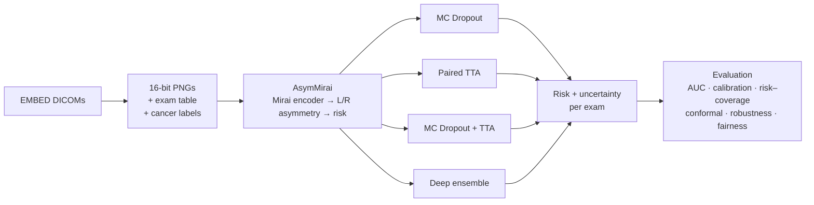

# Trust-Aware AsymMirai: Uncertainty Quantification for Mammography Risk Prediction

MSc Data Science dissertation project, University of Exeter.

Deep-learning breast cancer risk models output a single number, with no indication of when that number shouldn't be trusted. This project adds **uncertainty quantification** to [AsymMirai](https://github.com/jdonnelly36/AsymMirai), an interpretable 1–5-year breast cancer risk model that compares the left and right breast. The aim is for the model to report *how sure it is*, and to flag the exams it is least sure about for radiologist review.

> Research prototype. Not a medical device and not for clinical use.

---

## Approach



**Uncertainty methods**
- **MC Dropout**: stochastic forward passes with dropout on the image embeddings.
- **Paired test-time augmentation**: small rotations, shifts and contrast changes.
- **MC Dropout + TTA**: both combined.
- **Deep ensemble**: several dropout-trained heads with different seeds and bootstrap samples.
- **Conformal prediction**: class-conditional sets with a coverage guarantee. A set containing both labels means "refer".
- **Localisation uncertainty**: how often the model's "most asymmetric region" moves between stochastic passes.

## Key design decisions

| Decision | Why |
|---|---|
| **Paired dropout and TTA**: the same dropout mask and the same augmentation for the left and right breast | AsymMirai's score *is* the left/right difference. Independent noise on each side would create artificial asymmetry, so the "uncertainty" would be an artefact. |
| **Norm-preserving dropout scaling** (1/√(1−p) instead of 1/(1−p)) | Keeps the expected squared L2 asymmetry unchanged, so MC-averaged risks are not biased upwards. |
| **Dropout only in the head; backbone features cached** | The backbone runs once per exam and the K dropout samples reuse its output: about K× cheaper. |
| **Head re-fitted with dropout on** (backbone frozen) | MC Dropout approximates Bayesian uncertainty only if the model was trained with that dropout. |
| **Exam = accession number; 2D CC/MLO screening views only** | A patient has many exams over the years, and synthetic C-view and spot/mag images are not standard screening views. |
| **Patient-level calib/test split** | Referral thresholds and conformal quantiles are fitted on `calib` and reported on `test`, with no patient in both. |
| **Class-conditional (Mondrian) conformal** | With ~1–2% cancer prevalence, marginal 90% coverage could be met while missing most cancers. |
| **Re-implemented, device-agnostic forward pass** | Allows MC sampling on cached features and runs on CPU or GPU. Unit-tested equal to the original AsymMirai model to 1e-6. |

## Evaluation

Everything is reported on the held-out `test` split:

- **Discrimination**: 1–5-year AUC with stratified-bootstrap 95% CIs, plus Harrell's C-index
- **Calibration**: ECE (equal-frequency bins), Brier score, reliability diagrams
- **Is the uncertainty useful?**
  - Risk–coverage curves and AURC: does performance improve as the most uncertain exams are referred?
  - AUROC of uncertainty for detecting misclassifications
- **Robustness**: does uncertainty rise as Gaussian noise, blur or salt-and-pepper corruption gets more severe?
- **Fairness**: AUC, calibration and referral rate by race, breast density and age band
- **Conformal prediction**: empirical coverage overall and for cancer cases, and the fraction of exams referred

`python -m uq.evaluate` writes `report.md`, `metrics.json` and 11 figures.

## Status

- ✅ **Pipeline complete and tested.** 12 tests pass on CPU, including a full end-to-end run on synthetic 16-bit DICOMs: conversion → labels → head fine-tuning → all four UQ methods → evaluation and figures. A further test covers the free-tier path, including an interrupted and resumed run.
- ⏳ **Real-data evaluation on EMBED in progress.** Results will be added here.

---

## Quick start: free GPU (free Colab or Kaggle)

No paid GPU is needed. [`notebooks/free_tier_run.ipynb`](notebooks/free_tier_run.ipynb) runs the full evaluation on an **enriched case-control subset**: every cancer case (up to 100) plus 3 age-matched controls each, about 400 exams.

1. Plan the exams from the EMBED tables, before downloading anything.
2. Download only those ~1,600 images.
3. Store the PNGs at the model's input size, deleting each DICOM once it's converted.
4. Run inference in chunks of 25 exams. After a disconnect, re-running the cell resumes and gives identical results.

Settings are in [`configs/free_tier.yaml`](configs/free_tier.yaml).

```bash
python -m uq.data.build_metadata --config configs/free_tier.yaml --plan   # exam table from the EMBED tables
python -m uq.data.select_subset  --config configs/free_tier.yaml          # cases + matched controls
python -m uq.data.download_embed --config configs/free_tier.yaml --exam-csv
python -m uq.data.dicom_to_png   --config configs/free_tier.yaml
python -m uq.inference           --config configs/free_tier.yaml          # re-run the same line to resume
python -m uq.evaluate            --config configs/free_tier.yaml --run outputs/free_run
```

Because the subset is enriched, AUC, C-index, risk–coverage and uncertainty-vs-error are valid, but calibration and conformal set sizes reflect the enriched prevalence. The report flags this.

## Quick start: full dataset (Google Colab)

1. Clone this repo into Google Drive, e.g. `MyDrive/dissertation/AsymMirai_Uncertainty-Quantification`.
2. Download the **trained AsymMirai weights** (link in [`AsymMirai/README.md`](AsymMirai/README.md)) to `MyDrive/dissertation/weights/asymmirai_full_model.pt`.
3. Put the EMBED tables (`EMBED_OpenData_NUS_Datathon_clinical_reduced.csv`, `EMBED_OpenData_NUS_Datathon_metadata_reduced.csv`) in `MyDrive/dissertation/data/tables/`. EMBED is available on request from [Emory HITI](https://github.com/Emory-HITI/EMBED_Open_Data) and is **not** redistributed here.
4. Add `AWS_ACCESS_KEY_ID` / `AWS_SECRET_ACCESS_KEY` as **Colab Secrets**.
5. Open [`notebooks/run_quantification.ipynb`](notebooks/run_quantification.ipynb), select a GPU runtime, and run the cells in order. Run the 20-exam sanity check first.

## Command line

```bash
pip install -r requirements.txt
export ASYMMIRAI_UQ_ROOT=/path/to/folder/with/data_weights_outputs   # optional
export AWS_ACCESS_KEY_ID=... AWS_SECRET_ACCESS_KEY=...                # never commit these

python -m uq.data.download_embed --max-files 400      # 1. DICOMs from S3 (resumable)
python -m uq.data.dicom_to_png --workers 8            # 2. 16-bit PNGs + index
python -m uq.data.build_metadata                      # 3. exam table, labels, patient split
python -m uq.finetune_head --seeds 0 1 2 3 4          # 4. optional: dropout-trained heads / ensemble
python -m uq.inference --limit 20 --run-name sanity   # 5a. sanity check: predictions must vary
python -m uq.inference --run-name full                # 5b. all exams, all conditions
python -m uq.evaluate --run outputs/full              # 6. metrics, figures, report.md
streamlit run app/streamlit_app.py                    # 7. demo
pytest tests/                                         # tests (synthetic data, CPU)
```

All settings are in [`configs/uq_config.yaml`](configs/uq_config.yaml): paths, sample counts, dropout, corruption conditions, horizons and conformal α.

## Repository layout

```
├── uq/                        # this project's code
│   ├── data/
│   │   ├── download_embed.py     # S3 download (credentials from env / Colab Secrets)
│   │   ├── dicom_to_png.py       # 16-bit PNG conversion, MONOCHROME1 handling
│   │   ├── build_metadata.py     # exam grouping, labels, patient-level split
│   │   └── select_subset.py      # enriched case-control subset for free-tier runs
│   ├── preprocessing.py       # 16-bit loading, corruptions, paired TTA
│   ├── dataset.py             # 4-view exam dataset
│   ├── models/
│   │   ├── uq_asymmirai.py    # UQ-ready AsymMirai: paired dropout, Mirai/ResNet/ConvNeXt backbones
│   │   └── loading.py         # loads the released AsymMirai weights
│   ├── inference.py           # MC Dropout / TTA / MC+TTA / ensemble × clean + corrupted inputs (resumable)
│   ├── finetune_head.py       # dropout-trained heads, ensemble members, new-backbone heads
│   ├── metrics.py             # AUC (CI), C-index, ECE, Brier, risk–coverage, subgroups
│   ├── conformal.py           # class-conditional split conformal prediction
│   ├── evaluate.py            # report, metrics, figures
│   └── plotting.py            # figure style
├── AsymMirai/                 # third-party: original AsymMirai code (Donnelly et al., MIT), vendored unmodified
├── configs/
│   ├── uq_config.yaml         # full run
│   └── free_tier.yaml         # free GPU: enriched subset, lighter settings
├── notebooks/
│   ├── free_tier_run.ipynb    # free Colab / Kaggle
│   └── run_quantification.ipynb
├── app/streamlit_app.py       # demo: per-exam risk, uncertainty, referral flag
└── tests/                     # unit tests + synthetic end-to-end test
```

`AsymMirai/` is vendored unchanged because the released weights are a pickled model that needs the original class definitions to load. All of this project's code is in `uq/`, `app/`, `tests/` and `notebooks/`.

## Extensions

- **ConvNeXt-Tiny backbone**: set `model.backbone: convnext_tiny` and fit its head with `uq.finetune_head`. The asymmetry statistics are initialised from data.
- **Streamlit demo**: browse a run's results, or run live inference on four uploaded views.

## Credits

- **AsymMirai**: Donnelly et al., *AsymMirai: Interpretable Mammography-based Deep Learning Model for 1–5-year Breast Cancer Risk Prediction*, Radiology 2024. [Code](https://github.com/jdonnelly36/AsymMirai) (MIT).
- **Mirai**: Yala et al., 2021.
- **EMBED**: Jeong et al., 2023.
